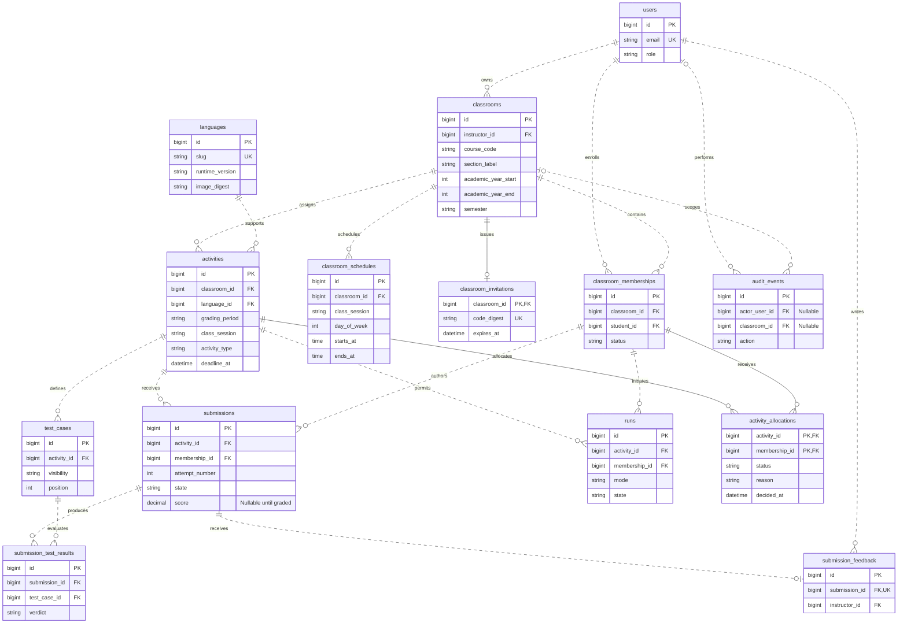

# Database Design

> **17 October 2026 update:** The current [functional requirements](functional-requirements.md#october-17-workflow-revision) supersede older no-score/attempt/Summer rules below. Manual points are stored in `submission_feedback.points_awarded`; `max_points` is required for new activities. Feedback accepts nullable `points_awarded` bounded by the activity maximum. Submission lists use IDs, not attempt numbers; reports show latest-submission points. Student numbers are required for new registration. Only First/Second semesters are accepted. Historical database fields and records are preserved.
> **Scope revision - 14 October 2026:** [Current functional requirements](functional-requirements.md) supersede older grading/export references below. CodeLab stores code submissions and instructor feedback, with no new scores, grading calculations or CSV/Excel exports. Completed means code was received. Run Java is deferred independently of submission. School: Asticassia School of Technology; no Facebook page supplied. Phases 6 and 7 resumed on 15 October 2026; see development-roadmap.md for current acceptance status. Older grading architecture and evidence are retained as historical design, not current commitments.

### Compatibility during scope revision

No destructive migration is applied. Existing submissions, feedback and academic records are preserved. New submissions use `state=submitted`, null score/results, and legacy non-null runtime/judge fields `not-executed`/`manual-review`. The application never calculates grades or exposes legacy scores. `max_points` is a retired compatibility column, set to zero for new activities and omitted from APIs/forms. Existing `test_cases` store optional public/private teaching examples; `test_suite_locked_at` protects examples after submission. A separately reviewed cleanup can remove retired schema fields later without discarding submitted source or feedback. Old grading jobs have a no-op compatibility handler and are no longer dispatched. Recovery only cleans expired legacy practice records.

Status: the full logical MySQL design remains the target. Phases 3-4 implement users, session/recovery infrastructure, classrooms/memberships, weekly schedules, invitations, the Java catalog, activities, tests, allocations and audits. Execution/submission/report tables remain future migrations. Laravel users.password stores the conceptual password_hash. The initial role, semester and status columns use constrained database enums; changes to their accepted values require an additive migration. Other planned fields and invariants are introduced with their owning phase. Follow [functional requirements](functional-requirements.md) for business invariants.

## Conventions and relationships

Use InnoDB, foreign keys, utf8mb4, explicit decimal scores and UTC microsecond timestamps. Internal IDs may be unsigned bigint; IDs are not authorization secrets. API represents IDs as strings to avoid JavaScript integer precision issues. Ordinary mutable records have created/updated timestamps. Store source and test payloads as UTF-8 text with byte-length validation. Prefer bounded strings plus validation/CHECK constraints for future evolving categories; the limited foundation enums are recorded above.

Relationship map:

- User (instructor) 1 → many classrooms.
- Classroom 1 → many classroom memberships; user (student) 1 → many memberships. Membership connects students and classrooms.
- Classroom 1 → zero/one current invitation; rotations replace its digest and create audit events.
- Classroom 1 → many activities; runtime language 1 → many activities.
- Activity 1 → many test cases and many submissions; membership 1 → many submissions and Runs.
- Activity and membership each 1 → many activity allocations, recording assigned/not-assigned eligibility without deriving it from mutable deadlines.
- Submission 1 → many test results and zero/one feedback note.
- Test case 1 → many submission test results.
- User/classroom 1 → many audit events where applicable.

Academic year, semester and section belong to the classroom, not separate catalogs in the MVP. Grading period, class session and activity type are constrained activity attributes. D01 is confirmed: one classroom represents one course, section and term, with its own roster and invitation code.

## Entity-relationship diagram

This logical ERD reflects the current planning model; unresolved policy choices remain in the overview. Display aliases match proposed table names. Key fields are shown here; the table catalog below contains the remaining fields and composite constraints. `||` means exactly one, `o|` zero or one, and `o{` zero or many. Dotted relationships reference independently keyed records; the invitation uses its classroom key as its own primary key.

The student-to-classroom many-to-many relationship is resolved by classroom_memberships. Activities have zero tests while in draft; publication requires both public and hidden tests. Submissions can have zero result rows while queued or after a compilation failure. Audit subjects use descriptive type/ID fields rather than an unenforceable polymorphic foreign key; actor and classroom references are the actual nullable FKs. Role-specific ownership and matching classroom relationships require the transaction checks below as well as foreign keys.

## Tables

| Table | Principal fields and constraints |
| --- | --- |
| `users` | id; name; normalized email UNIQUE; password_hash; role (`student`, `instructor`); nullable student_number UNIQUE; email_verified_at; disabled_at; timestamps. Institution identity format is D12. Never accept role through public registration |
| `classrooms` | id; instructor_id FK users; title; course_code; section_label; academic_year_start; academic_year_end; semester; term_end_date; timezone; status (`active`, `archived`); archived_at; timestamps. Validate end year = start year + 1 and term end is within the intended academic term |
| `classroom_memberships` | id; classroom_id FK; student_id FK users; status (`active`, `removed`); joined_at; removed_at; timestamps. UNIQUE(classroom_id, student_id); joined_at preserved during reactivation |
| `classroom_schedules` | id; classroom_id FK; class_session (oc/lab); day_of_week (1-7); starts_at/ends_at in classroom timezone. Up to 14 non-overlapping same-day slots, validated transactionally |
| `classroom_invitations` | classroom_id PK/FK; code_digest UNIQUE; expires_at; revoked_at; created_at/updated_at. At most one current code per classroom; HMAC digest only, never recoverable plaintext |
| `languages` | id; slug UNIQUE (e.g. `java` for the first pinned runtime); display_name; runtime_version; image_digest; judge_version; enabled; timestamps. Operationally maintained allowlist, not instructor CRUD. Phase 4 seeds the Temurin Java 21 authoring catalog; image_digest/judge_version stay nullable until Phase 5 pins a verified execution image. Execution remains disabled. Referenced versions immutable; a later runtime release gets a distinct record/slug |
| `activities` | id; classroom_id FK; language_id FK; title; instructions; grading_period; class_session; activity_type; max_points DECIMAL(7,2); submission_limit; deadline_at; status (`draft`, `published`, `archived`); published_at nullable; archived_at nullable; test_suite_locked_at nullable; assessment_digest nullable; timestamps |
| `test_cases` | id; activity_id FK; position; visibility (`public`, `hidden`); stdin; expected_stdout; explanation nullable; timestamps. UNIQUE(activity_id, position). All tests contribute equally. Explanation is public only when test is public |
| `activity_allocations` | activity_id FK; membership_id FK; composite PK(activity_id, membership_id); status (`assigned`, `not_assigned`); reason (`published_to_member`, `open_on_join`, `closed_on_join`); decided_at. Immutable automatic allocation; reactivation uses the same open/closed rules for missing rows only. No manual editing API in MVP |
| `submissions` | id; activity_id FK; membership_id FK; attempt_number; idempotency_key; request_hash; source_code; source_hash; assessment_digest; runtime_image_digest; judge_version; accepted_at; state; outcome nullable; score DECIMAL(7,2) nullable; execution fields below. UNIQUE(activity_id, membership_id, attempt_number); UNIQUE(membership_id, idempotency_key) |
| `submission_test_results` | id; submission_id FK; test_case_id FK; verdict; execution_ms; memory_kib nullable; stdout; stderr; output_truncated; UNIQUE(submission_id, test_case_id). Private by default; expose public results through explicit serializer only |
| `runs` | id; activity_id FK; membership_id FK; idempotency_key; request_hash; source_code; source_hash; mode (`public`, `custom`); custom_stdin nullable; public_tests_snapshot JSON nullable; runtime_image_digest; judge_version; state; outcome nullable; public_results JSON nullable; execution fields below; created_at; expires_at. UNIQUE(membership_id, idempotency_key). Public mode snapshots ordered public inputs/expected outputs under the activity lock; no hidden tests. No score or assessed attempt number |
| `submission_feedback` | id; submission_id FK UNIQUE; instructor_id FK users; body; created_at; updated_at. One owner-authored note per submission, editable and audited |
| `audit_events` | id; actor_user_id nullable FK; classroom_id nullable FK; action; subject_type; subject_id; correlation_id; safe_metadata JSON; occurred_at. Append-only application behavior; metadata limited to identifiers and nonsensitive change summaries |

Common execution fields on submissions and Runs: `started_at`, `finished_at`, `dispatch_attempts`, `last_dispatched_at`, `execution_generation`, `lease_expires_at`, `runner_job_id` nullable, `system_error_code` nullable, bounded `compiler_stdout`/`compiler_stderr` nullable, `updated_at`. Compiler diagnostics are collected before any test input is mounted; sanitize host paths and expose only safe compiler messages to the authorized student. This small deliberate duplication keeps Run and assessed data separate without an extra polymorphic job hierarchy. Queue messages contain resource kind/ID only; workers load authoritative records.

Framework-managed session, password-reset and failed-job storage will be selected during initialization. These are infrastructure tables, not additional user-facing resources. Database sessions are the initial proposal, keeping Redis focused on queues/rate limiting. Failed-job payloads contain IDs rather than source/tests or secrets.

## State and integrity

Submissions and Runs have `queued`, `running`, `graded`, `system_error` states. For a Run, `graded` means execution finished, not an academic assessment. A submission's outcome is one of `accepted` (all tests passed), `wrong_answer`, `compile_error`, `runtime_error`, `time_limit_exceeded`, or `output_limit_exceeded`. If multiple failures occur, the first failing test in defined order determines the summary outcome; per-test results retain full authorized detail. Runs use `finished` for custom execution success or the same failure outcomes; no numeric grade is issued.

Only graded submissions have a non-null score. Queued/running/system-error records have null scores. Require 0 ≤ score ≤ frozen max_points. All tests must finish coherently before final grade commit; partial test rows are not exposed as final results. Test results and terminal grade become visible together in a transaction. Source, admission timestamp and attempt number are immutable after admission.

Relational checks that span tables must also be enforced in the application transaction: classroom owner has instructor role; membership user has student role; allocation/submission/Run membership and activity share a classroom; a new submission/Run requires an assigned allocation; result test belongs to submission's activity; feedback author owns that classroom. Simple FKs alone do not prove these. Tests must exercise mismatched references, including worker persistence paths.

Publication, joining and reactivation create missing allocation rows transactionally with the respective lifecycle operation. Use the same classroom lock to serialize joins against publication and deadline/archive changes. Existing allocations are never overwritten. This captures late-join eligibility once, while later deadline extensions still apply to already assigned students. Never infer eligibility simply from the current deadline when producing historical reports. A removed member may have no allocation for an activity published during removal; reports treat that absent allocation as not assigned until reactivation creates the appropriate row.

Published activities retain published_at when archived, distinguishing historical assignments from archived drafts. Freeze non-test assessment fields at publication. Test rows may change until test_suite_locked_at is set by the first accepted assessed submission; authorized test edits and admission take the same activity lock. Recompute the assessment digest after each permitted test edit. The digest covers the statement, categorization, ordered test suite, equal-test scoring rule, max points and language/judge version. Deadlines and attempt limits are separately mutable only under the permitted audited increases. Submissions record provenance, not copies of every test payload; referenced tests and runtime rows cannot be edited or removed while assessed records depend on them. Runs execute their captured public-test snapshot, so later permitted edits do not affect an in-flight Run.

## Atomic admission and dispatch

Within one transaction, acquire locks consistently (classroom → activity → membership), verify authorization and current constraints, then find an existing idempotency record before evaluating new-admission deadline/limit rules. Reject a replay body mismatch. For a genuinely new attempt, require an assigned allocation, count queued/running/graded submissions, reject concurrent in-flight work, allocate `max(attempt_number)+1`, set test_suite_locked_at if absent, and insert immutable source plus queued state and the current assessment digest. Unique constraints are a second line of defense. Keep these transactions short and never call the runner while locks are held.

Archive/remove/settings operations use compatible locks; avoid lock-order inversion. The pilot accepts short per-classroom admission serialization for simplicity. Benchmark before replacing it with finer locks.

Dispatch only after database commit. A scheduler scans queued records that lack a fresh dispatch/lease and safely re-enqueues them, closing the database-commit/Redis-publish failure gap. A worker claims a record atomically, increments execution_generation and establishes a lease; only that generation may commit a terminal result. Duplicate queue deliveries see the existing claim/result and exit. Lease expiry allows bounded recovery; stale generation results are rejected. Redis is never the attempt counter or durable source store.

## Indexes and derived data

Add indexes for classrooms(instructor_id, status), memberships(student_id, status), activities(classroom_id, grading_period, status), submissions(activity_id, membership_id, accepted_at), submissions(state, lease_expires_at), Runs(state, lease_expires_at), Runs(expires_at), and audit_events(classroom_id, occurred_at). Existing unique keys support membership and idempotency lookup. Add further indexes only against observed queries.

Derive best score, attempts used and progress states from assessed records using one shared calculation. Do not store competing mutable totals on users or memberships. Reports use a consistent snapshot and bounded queries; no separate analytics store or cached gradebook in MVP. Decimal arithmetic and deterministic tie breaking must match the API, UI and CSV.

## Retention and deletion

Restrict deletion of referenced academic records. Draft deletion may explicitly remove its unreferenced tests in a transaction. Classroom archival and membership removal retain data. Expiring Runs may be purged as a unit after their retention period and only after execution has been terminated. Academic purges are coordinated operational jobs after approved retention, with referential order and backups accounted for; no blanket cascade deleting graded submissions on user removal.

## Phase 5 schema implementation note

Migration `2026_10_14_000210_create_assessment_tables.php` adds `submissions`, `practice_runs` and `submission_feedback`. Each execution record retains immutable source/hash, runtime identity, assessment digest, request hash/idempotency key, acceptance time, status and fenced execution generation/lease. Unique membership/idempotency keys prevent replay duplication; assessed attempt numbers are unique per activity/membership. Feedback is unique per submission and owned by an instructor.

For this local implementation, bounded test verdicts and stdout/stderr are stored in a private `results` JSON column rather than a separate per-test result table. Practice snapshots also use private JSON. The API uses explicit serializers, never raw model serialization. Reports select only score/status/identity/timing columns and derive totals without loading source or test output. No separate mutable grade-total table is introduced. This compact physical representation preserves the planned relationships and privacy boundary.
